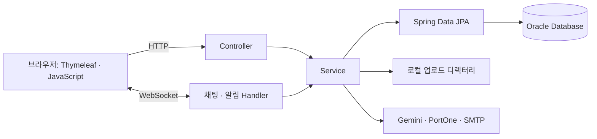

# PIKA v2 | 개인 리뉴얼 프로젝트

종료된 6인 팀 프로젝트 PIKA를 기반으로 진행하는 개인 리뉴얼 프로젝트입니다. 원본 Git 이력을 유지하며, 개인 리뉴얼 작업은 이 저장소의 후속 커밋으로 기록합니다.

- **진행 상태**: 리뉴얼 시작 · 원본 코드 이관 완료
- **원본 저장소**: [SoldeskFinalProject-Pika](https://github.com/geonhui-0125/SoldeskFinalProject-Pika)
- **주요 방향**: React MVVM 마이그레이션, JWT 인증 전환, Oracle 유지, MongoDB·Redis 기반 메시징, Python gRPC·Gemini AI 서비스 분리
- **v2 설계**: [기술명세 초안](docs/technical-spec.md)

아래 기능·구조 설명은 이관한 원본 구현의 기록입니다. 리뉴얼 방향은 6번에 정리했으며, 구현이 진행되면 완료 범위와 검증 결과를 갱신합니다.

---

## 원본 프로젝트: PIKA

> 상품 탐색부터 가격 비교, 판매자와의 대화, 거래 이력 확인까지 연결하는 웹 서비스

PIKA는 **서브컬처 굿즈를 사고파는 사용자의 정보 탐색 부담을 줄이기 위해 만든 6인 팀 프로젝트**입니다. 상품·거래 데이터를 Oracle에 저장하고, Gemini API를 이용해 상품 시세와 판매자 리뷰를 해석하는 보조 기능을 제공합니다.

- **원본 프로젝트 상태**: 개발·발표 종료
- **팀**: Numlock
- **구현 형태**: Spring Boot · Thymeleaf 기반 서버 렌더링 웹 애플리케이션
- **주요 구현 영역**: 상품 검색·관리, 회원·마이페이지, 채팅·알림, 결제 연동, AI 시세 분석·리뷰 요약
- **기획 및 역할 분담 자료**: [프로젝트 기획서](docs/기획서(2차_기획서_NUMLOCK).txt) · [발표 자료](docs/Numlock%202차%20프로젝트%20PPT.odp)

이 README의 구현 설명은 현재 소스 코드를 기준으로 합니다. 팀 전체의 구현 범위를 다루며, 개인별 담당 범위는 기획서의 역할 분담 자료에서 확인할 수 있습니다.

## 1. 기획 배경과 사용자 흐름

서브컬처 굿즈는 같은 캐릭터의 상품도 종류와 상태가 다양합니다. 판매자는 가격을 정하기 위해 여러 게시글을 비교해야 하고, 구매자는 원하는 상품과 판매자 정보를 따로 찾아야 합니다. PIKA는 상품 탐색과 거래 기능을 한 서비스 안에 모으고, AI가 가격 비교와 리뷰 파악을 보조하도록 구성했습니다.

| 사용자 | 이용 흐름 | 제공 기능 |
| --- | --- | --- |
| 판매자 | 상품 등록 → 가격 참고 → 구매자와 대화 → 거래 확인 | 이미지 업로드, AI 시세 분석, 1:1 채팅, 판매 내역 |
| 구매자 | 검색·카테고리 탐색 → 상품·판매자 확인 → 문의·구매 → 리뷰 | 검색·페이징, 찜, 리뷰·평점, 채팅, 결제 연동, 구매 내역 |
| 관리자 | 회원·상품 조회 → 관리 | 관리자 회원·상품 관리 화면 |

AI 분석은 구매·판매 판단을 돕는 참고 정보이며, 실제 적정가나 거래 결과를 보장하지 않습니다.

## 2. 주요 기능

| 영역 | 구현 내용 | 대표 코드 |
| --- | --- | --- |
| 회원 | 회원가입, 폼 로그인, BCrypt 비밀번호 암호화, 계정 관리, 이메일 비밀번호 재설정 | [LoginSecurity](pika/src/main/java/com/numlock/pika/config/LoginSecurity.java), [회원 컨트롤러](pika/src/main/java/com/numlock/pika/controller/user/UserController.java) |
| 상품·탐색 | 상품 등록·수정·조회, 다중 이미지, 키워드·카테고리 검색, 목록 페이징, 인기 검색어 | [상품 서비스](pika/src/main/java/com/numlock/pika/service/product/ProductServiceImpl.java), [검색 조건](pika/src/main/java/com/numlock/pika/service/product/ProductSpecification.java) |
| 마이페이지 | 사용자 정보, 찜 목록, 구매·판매 내역, 리뷰·알림 관리 | [계정 컨트롤러](pika/src/main/java/com/numlock/pika/controller/user/AccountController.java), [거래 내역](pika/src/main/java/com/numlock/pika/controller/payment/TradeHistoryController.java) |
| 실시간 소통 | WebSocket 1:1 채팅, 메시지 저장, 이미지 첨부, 알림 | [채팅 핸들러](pika/src/main/java/com/numlock/pika/handler/WebSockChatHandler.java), [알림 서비스](pika/src/main/java/com/numlock/pika/service/Notification/NotificationService.java) |
| 거래·리뷰 | PortOne 결제 정보 조회, 결제 내역 저장·상품 상태 변경, 구매 이력 기반 리뷰 작성, 중복 리뷰 방지 | [결제 서비스](pika/src/main/java/com/numlock/pika/service/payment/PaymentApiService.java), [리뷰 서비스](pika/src/main/java/com/numlock/pika/service/ReviewServiceImpl.java) |
| AI | 상품 시세 분석, 내부 상품 검색과 외부 웹 검색을 연결하는 챗봇, 판매자 리뷰 요약 | [GeminiService](pika/src/main/java/com/numlock/pika/service/GeminiService.java) |

## 3. 구현 포인트

### 상품 데이터와 외부 검색을 연결하는 AI 분석

`GeminiService`는 모델이 호출할 수 있는 도구를 정의하고, 도구 호출 결과를 다시 모델에 전달합니다. 상품 시세 분석은 상품 상세와 내부 평균 가격을 조회한 뒤 Google Search 도구로 외부 가격 정보를 검색하도록 구성했습니다. 챗봇은 내부 상품 검색과 외부 웹 검색을 선택할 수 있으며, 도구 호출 루프는 최대 5회로 제한합니다.

이 구조는 AI 응답에 실제 상품 정보를 전달하고, 내부 데이터만으로 답하기 어려운 질문에는 외부 검색을 연결하려는 구현입니다. 가격 정확도나 사용자 만족도 개선에 대한 정량 평가는 아직 포함되어 있지 않습니다.

### 실시간 전달과 메시지 보관을 함께 처리

채팅은 STOMP 브로커 대신 Spring의 `TextWebSocketHandler`로 구현했습니다. 인증된 사용자의 ID와 WebSocket 세션을 `ConcurrentHashMap`에 보관하고, 수신자의 접속 여부에 따라 메시지를 전달합니다. 메시지는 DB에 저장하며, 수신자가 오프라인이면 알림을 생성합니다.

현재 세션 관리는 단일 애플리케이션 인스턴스를 기준으로 합니다. 여러 서버로 확장하려면 세션 라우팅과 메시지 중계를 별도로 설계해야 합니다.

### 조건 조합과 연관 데이터 조회

상품 검색은 JPA `Specification`으로 키워드와 카테고리 조건을 조합하고, 목록은 페이지 단위로 조회합니다. 찜 목록은 [Fetch Join 쿼리](pika/src/main/java/com/numlock/pika/repository/FavoriteProductRepository.java)를 사용해 찜 항목과 상품을 함께 가져옵니다. 조회 시 필요한 연관 데이터를 명시적으로 선택한 사례이며, 성능 개선율을 측정한 결과는 없습니다.

### 거래 이력을 기준으로 리뷰 작성 제한

리뷰 작성 시 구매 이력, 자기 자신에 대한 리뷰 여부, 동일 상품의 중복 리뷰 여부를 서비스 계층에서 확인합니다. 수정은 작성자, 삭제는 작성자 또는 관리자 여부를 검사합니다. 화면에서 버튼을 숨기는 처리와 별도로 서비스에 검증 로직을 둡니다.

## 4. 기술 스택과 구조

| 구분 | 기술 | 사용 영역 |
| --- | --- | --- |
| 언어·빌드 | Java 17, Gradle Wrapper 8.14.3 | 애플리케이션 개발·의존성 관리 |
| 서버 | Spring Boot 3.4.12, Spring MVC | 요청 처리, 화면 렌더링, JSON API |
| 화면 | Thymeleaf, HTML, CSS, JavaScript | 서버 데이터 바인딩, 비동기 요청 |
| 데이터 | Spring Data JPA, Oracle Database, ojdbc11 | 엔티티 매핑, 검색, 거래·메시지 저장 |
| 인증 | Spring Security, BCrypt | 폼 로그인, 비밀번호 암호화 |
| 실시간 통신 | Spring WebSocket | 채팅·알림 |
| 외부 연동 | Google Gen AI SDK, PortOne, SMTP, CoolSMS SDK | AI 분석, 결제, 이메일 및 SMS 연동 코드 |



Controller는 요청과 응답을 처리하고, Service는 업무 로직과 트랜잭션을 담당합니다. Repository는 JPA 기반 데이터 접근을 담당하며, 상품·회원·거래·리뷰·메시지 등을 엔티티로 관리합니다.

```text
src/main/java/com/numlock/pika/
├── config/       # 보안, WebSocket, 정적 파일 경로 설정
├── controller/   # 화면 및 API 요청 처리
├── domain/       # JPA 엔티티
├── dto/          # 요청·응답 데이터
├── handler/      # 채팅·알림 WebSocket 처리
├── repository/   # 데이터 조회·저장
└── service/      # 업무 로직, 외부 서비스 연동
src/main/resources/
├── static/       # CSS, JavaScript, 아이콘
└── templates/    # Thymeleaf 화면
```

## 5. 로컬 실행

### 준비 사항

- JDK 17
- Oracle Database와 프로젝트 전용 스키마
- 외부 기능을 사용할 경우 Gemini·PortOne·SMTP 등의 자격 증명

Gradle은 별도로 설치할 필요가 없습니다. 최초 실행에는 의존성 다운로드를 위한 네트워크 연결이 필요합니다.

### DB와 목업 데이터

| 자료 | 용도 |
| --- | --- |
| [table_create_query.txt](table_create_query.txt) | 테이블·시퀀스와 기본 카테고리 정의 |
| [datasetAdd (카테고리 수정본).txt](datasetAdd%20(카테고리%20수정본).txt) | 카테고리가 반영된 상품·리뷰 예시 데이터 |
| [mock.zip](mock.zip) | 예시 상품 이미지와 데이터 SQL |

초기 SQL은 그대로 실행하기 전에 다음 사항을 확인해야 합니다.

- 테이블·시퀀스 삭제와 상품 전체 삭제 구문이 있으므로 **비어 있는 개발용 스키마**를 사용합니다.
- `MESSAGES`는 `PRODUCTS`를 참조하므로 상품 테이블을 먼저 생성해야 합니다.
- 목업 데이터가 참조하는 `tester1`, `tester2` 사용자를 먼저 준비해야 합니다.
- 일부 상품명에 포함된 작은따옴표는 SQL 문자열 규칙에 맞게 이스케이프해야 합니다.
- 한글과 긴 설명을 담을 수 있도록 상품 제목·설명 칼럼의 문자 길이를 확인해야 합니다. 로컬 목업 적재 시 제목은 `VARCHAR2(500 CHAR)`, 설명은 `VARCHAR2(4000 CHAR)`로 확장했습니다.

이미지는 ZIP의 `mock/images/` 아래 UUID 디렉터리들을 상품 업로드 경로 바로 아래에 배치합니다. 예를 들어 `products/{UUID}/image_0.jpg` 구조를 유지하면 `/upload/{UUID}/image_0.jpg`로 접근할 수 있습니다.

### 애플리케이션 설정

기본 설정은 [application.properties](pika/src/main/resources/application.properties)에서 읽습니다. 실제 비밀번호와 API 키는 커밋하지 않고 로컬 설정 또는 환경 변수로 제공합니다.

| 속성 | 설정 내용 |
| --- | --- |
| `spring.datasource.url`, `username`, `password` | Oracle JDBC 주소와 전용 스키마 계정 |
| `file.upload-path`, `file.chat-upload-path` | 상품·채팅 이미지의 쓰기 가능한 로컬 절대 경로 |
| `gemini.api.key` | Gemini API 키 |
| `imp.code`, `imp.access`, `imp.secret` | PortOne 가맹점·API 정보 |
| `spring.mail.username`, `spring.mail.password`, `spring.mail.properties.mail.smtp.from` | 비밀번호 재설정 이메일 발송 계정 |
| `coolsms.apiKey`, `coolsms.secretkey` | SMS 연동 자격 증명 |
| `jwt.secret` | 미사용 JWT 유틸리티의 설정 항목. 현재 세션 로그인에는 사용하지 않음 |

로그인은 프로젝트 일정 내에 회원·거래 기능을 완성하기 위해 **Spring Security 폼 로그인·HTTP 세션 방식**으로 구현했습니다. JWT 유틸리티와 의존성은 도입 검토 과정에서 남은 미사용 코드이며, 실제 인증 흐름에는 사용하지 않습니다. 리뉴얼 프로젝트에서는 JWT 기반 인증으로 전환할 예정입니다.

프로필 이미지는 사용자 홈의 `pika_uploads/profile` 경로를 사용합니다.

프로젝트 디렉터리에서 실행합니다. 다음은 Oracle XE의 PDB에 연결하는 Linux/macOS 예시입니다. DB 계정 환경 변수는 실행 전에 설정하세요.

```bash
cd SoldeskFinalProject-Pika-v2/pika
mkdir -p "$HOME/pika_uploads/products" "$HOME/pika_uploads/chat"

export SPRING_DATASOURCE_URL='jdbc:oracle:thin:@//localhost:1521/XEPDB1'
export SPRING_DATASOURCE_USERNAME="$DB_USERNAME"
export SPRING_DATASOURCE_PASSWORD="$DB_PASSWORD"
export FILE_UPLOAD_PATH="$HOME/pika_uploads/products/"
export FILE_CHAT_UPLOAD_PATH="$HOME/pika_uploads/chat/"

./gradlew bootRun
```

Windows에서는 동일한 설정을 환경 변수로 제공한 뒤 `gradlew.bat bootRun`을 실행합니다. 기본 포트는 `8080`이며, 포트가 사용 중이면 `SERVER_PORT=8081`로 변경할 수 있습니다. 배포용 WAR는 `./gradlew bootWar`로 생성하며 결과는 `build/libs/`에 저장됩니다.

## 6. 프로젝트 회고와 리뉴얼 방향

PIKA는 팀 프로젝트의 개발과 발표를 마친 프로젝트입니다. 제한된 일정 안에서 상품 탐색부터 채팅, 결제 연동, 리뷰까지 중고거래의 주요 흐름을 구현하고, AI를 가격 비교와 판매자 정보 파악에 연결했습니다.

리뉴얼 프로젝트에서는 채팅과 AI가 웹 애플리케이션 내부에 결합된 구조를 재설계하고, 인증·거래 검증과 운영 기반을 보강할 계획입니다. 아래 내용은 기존 구현에서 확인한 한계와 리뉴얼의 설계 방향입니다.

### 메시징: 저장·전달·접속 관리의 책임 분리

기존 채팅은 하나의 Spring Boot 애플리케이션 안에서 WebSocket 연결 관리, 수신자 라우팅, Oracle 저장, 알림 생성을 처리합니다. 별도 메시지 브로커 없이 핸들러가 직접 중계하며, 사용자별 접속 정보도 해당 프로세스의 메모리에 보관합니다.

| 기존 구조의 한계 | 리뉴얼 방향 |
| --- | --- |
| 핸들러에서 메시지를 직접 저장·전달하며, 애플리케이션 수준의 영속 큐가 없음 | 메시지 수신과 저장·전달 사이에 브로커와 버퍼를 도입하고, 처리량 제한·재시도·실패 메시지 처리를 설계 |
| 저장 전에 발신자 화면에 메시지를 반환하므로 저장 실패와 전송 성공을 구분하기 어려움 | 메시지 ID와 처리 상태를 정의하고, 저장 확인 응답과 수신·읽음 확인을 구분. 재전송 시 중복 처리 방지 |
| 사용자 ID당 WebSocket 세션 하나를 메모리에 보관 | 다중 기기·탭의 접속을 관리하고, 여러 서버에 연결된 사용자에게 메시지를 라우팅할 수 있도록 접속 관리와 중계 계층 분리 |
| Oracle의 메시지 저장·조회가 상품·거래 데이터와 같은 애플리케이션에 결합 | 대화방·시간순 조회와 보관 정책에 맞춰 메시지 저장 모델을 재설계하고 NoSQL 저장소 분리를 검토. 상품·결제 등 거래 데이터는 RDB에서 관리 |
| 접속 여부를 메시지 저장 시 읽음 값에 반영 | 온라인 여부, 전달 완료, 실제 읽음을 별도 상태로 관리하고 재접속 시 누락 메시지를 조회하는 흐름 설계 |

브로커 도입은 메시지 수신과 후속 처리를 분리하기 위한 것이고, NoSQL 전환은 메시지의 저장·조회 패턴을 다루기 위한 선택입니다. 두 변경은 별도로 검토하며, 대화방별 순서 보장, 중복 제거, 조회 페이지네이션, 데이터 이관 기준을 먼저 정한 뒤 부하·장애 상황에서 검증할 계획입니다.

### AI: Python 서비스로 분리

기존 `GeminiService`는 모델 호출, 프롬프트, 상품 Repository 조회, 도구 실행, 대화 이력 관리를 하나의 Java 서비스에서 담당합니다. 시세 분석과 챗봇 요청도 웹 요청 처리 흐름 안에서 외부 모델 응답을 기다리는 구조입니다.

리뉴얼에서는 **Python 기반 AI 서비스로 분리**하여 모델·프롬프트·검색 로직을 독립적으로 변경하고 배포할 수 있도록 구성할 계획입니다.

- **서비스 경계**: Spring Boot는 회원·상품·거래와 접근 권한을 담당하고, Python 서비스는 시세 분석·대화·리뷰 요약을 담당하도록 분리합니다. 상품 정보는 명시적인 내부 API 계약을 통해 전달하고, AI 서비스가 업무 DB에 직접 의존하는 범위를 줄입니다.
- **요청 처리**: 즉시 응답이 필요한 대화와 오래 걸리는 분석 작업을 구분하고, 타임아웃·취소·동시 실행 수 제한 및 필요한 작업의 비동기 큐 처리를 설계합니다.
- **대화 상태와 비용 관리**: 프로세스 메모리에 누적하는 대화 이력을 외부 저장소로 옮기고, 보관 기간·문맥 길이·사용자별 요청 한도를 설정합니다. 분석 결과 캐시는 상품 변경과 데이터 최신성을 고려해 적용 여부를 결정합니다.
- **응답 품질과 관측**: 프롬프트 버전과 평가용 질문·상품 데이터를 관리하고, 시세 응답의 근거·기준 시점·실패 응답을 점검합니다. 응답 시간, 토큰 사용량, 외부 API 오류를 기록해 품질과 비용을 함께 평가할 계획입니다.

### 인증·거래·개발 환경 보강

- **인증·권한**: 기존 프로젝트에서는 일정상 세션 로그인을 채택했습니다. 리뉴얼에서는 미사용 상태로 남아 있는 JWT 코드를 정리하고 JWT 기반 인증으로 전환할 예정입니다. 개발용 전체 경로 허용 설정을 정리하고, 엔드포인트별 인증·소유권 검증과 인증 방식에 맞는 CSRF 정책을 설계하며, 초기 관리자 계정 설정도 외부화할 계획입니다.
- **결제 검증**: 기존 구현은 PortOne 응답 존재 여부와 요청 금액·DB 상품 가격을 확인합니다. 리뉴얼에서는 PortOne 응답의 실제 결제 금액·상태·주문 연결 검증을 보강하고, 중복 결제 요청과 동시 구매에 대한 처리 기준을 마련할 계획입니다.
- **DB 초기화**: 테이블 생성 순서, 문자열 이스케이프, 문자 길이 설정을 정리하고, DB 마이그레이션과 반복 실행 가능한 시드 스크립트로 개발 환경을 재현할 수 있도록 개선할 계획입니다.
- **테스트·평가**: 자동화 테스트가 없는 기존 구현을 바탕으로 구매·리뷰 권한과 거래 상태 전이를 검증하는 테스트를 추가할 계획입니다. 메시지 중복·순서·재접속, AI 서비스 지연·실패 등 서비스 분리 후의 경계도 검증 대상으로 삼습니다.
- **운영 기반**: 업로드 파일 저장소를 애플리케이션에서 분리하고, 웹·메시징·AI 서비스 간 요청을 추적할 수 있는 로그와 지표, 배포·설정 관리 방식을 정리할 계획입니다.
