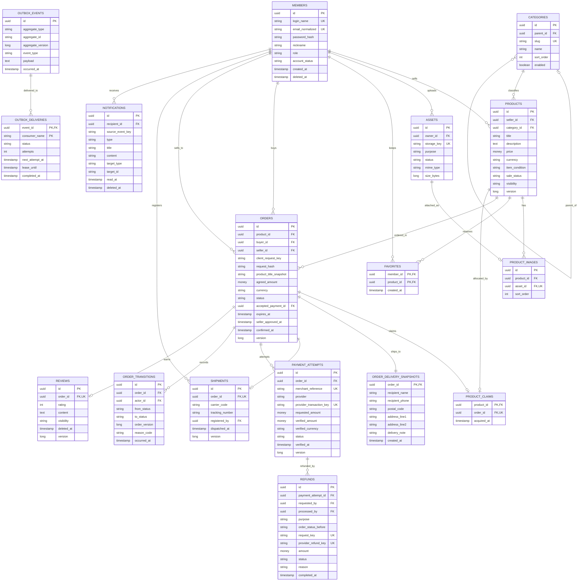

# PIKA v2 데이터 모델·ERD 초안

- 갱신일: 2026-11-08
- 상태: **논리 모델 초안**. 신규 v2 구현을 위한 설계이며, 기존 테이블을 유지하거나 데이터를 자동 이관하는 설계가 아니다.
- 기준: [기능명세](functional-spec.md), [기술명세](technical-spec.md).
- 확정: 게시글 1건은 물품 또는 묶음 **한 번 판매**. 샌드박스 결제·구매 확정·리뷰를 포함한다.
- 거래 정책: 판매자 승인 후 배송 준비, 택배·운송장 수동 입력, 발송 전 구매자 취소·이후 관리자 처리. [정책·상태 전이 검토](transaction-policy.md).
- 설계 제안: 아래 테이블·컬렉션·상태·제약. 정책 미정 항목은 이 문서 마지막에 따로 명시한다.
- 물리 DDL·Flyway 마이그레이션·시딩은 모델 검토 후 작성한다. 이 문서만으로 DB를 변경하지 않는다.

## 1. 저장소별 원본과 소유권

| 데이터 | 원본 | 쓰기 소유 모듈 | 비고 |
| --- | --- | --- | --- |
| 회원·상품·거래·결제·리뷰 | Oracle | 각 업무 모듈 | 결제·리뷰 자격의 최종 판단 기준 |
| 업로드 파일 메타데이터 | Oracle | 미디어 모듈 | 파일 본문은 파일 저장소 |
| 채팅방·메시지·읽음 위치·AI 대화 | MongoDB | Spring 메시징 모듈 방향 | [대화 문서 모델](messaging-data-model.md). Python에는 필요한 문맥을 전달 |
| 메시지 처리 버퍼·임시 접속 정보 | Redis | 메시징 모듈 | 버퍼 재처리와 MongoDB 이력의 역할 구분 |
| 상품 텍스트·벡터 검색 | Elasticsearch | 검색 모듈·색인 소비자 | Oracle 상품에서 재생성 가능한 파생 데이터 |
| 관제 로그·지표 | 관제 저장소 | 관제 수집기 | 업무 원본이나 결제 감사 기록을 대체하지 않음 |

Oracle과 MongoDB 사이에는 DB FK나 공통 트랜잭션이 없다. 공통 ID를 저장하되 참조 검증·변경 이벤트·실패 복구는 모듈 API와 이벤트 처리로 수행한다.

## 2. Oracle 핵심 ERD

`uuid`, `money`, `boolean`, `text`는 논리 타입이다. 다이어그램은 주요 필드만 표시하며, 복합 유일성·일부 참조는 아래 제약표를 기준으로 한다. 코드·DDL에서는 예약어 혼동을 피하도록 `ORDERS` 등 복수형을 사용한다.

[Mermaid 원본](erd/oracle-core.mmd)

## 3. 공통 규칙과 타입 제안

- ID는 애플리케이션에서 생성한 UUID를 공통 형식으로 사용한다. Oracle은 `VARCHAR2(36 CHAR)`, MongoDB·계약에서도 동일한 소문자 문자열을 쓰는 안이다. RAW(16) 최적화는 필요 시 별도 검토한다.
- 통화는 첫 범위에서 KRW로 제한하는 제안이다. 금액은 `NUMBER(19,0)`의 원 단위 정수, 금액·통화 일치 검증을 함께 수행한다. 음수 가격은 거부한다. 0원 상품 허용 여부는 미정이다.
- 시간은 UTC 기준 `TIMESTAMP WITH TIME ZONE`으로 저장한다. 문자열 기반의 클라이언트 시각을 메시지·거래의 최종 순서로 사용하지 않는다.
- 사용자 문자열은 문자 길이를 명시한다. 상품·리뷰 본문과 이벤트 payload는 CLOB 후보로 두며, API에서도 별도 길이 상한을 검증한다.
- 갱신 가능한 집계에는 `version`과 `created_at`, `updated_at`을 둔다. 조회 정렬에는 시각과 ID를 함께 사용한다.
- nullable은 의미가 있을 때만 허용한다. 다이어그램의 UK 표시는 nullable 필드의 NOT NULL을 뜻하지 않는다.
- 주문·결제·환불 이력과 참조되는 회원·상품은 연쇄 물리 삭제하지 않는다. 탈퇴·비공개·삭제 표시는 거래 이력 보존과 개인정보 익명화 정책을 구분한다.

## 4. 엔티티 책임과 주요 제약

### 회원·상품

| 엔티티 | 설계 내용 | 제약·접근 경로 |
| --- | --- | --- |
| `MEMBERS` | 인증 식별자와 계정 상태. 판매자·구매자는 거래상의 역할. 전역 권한은 우선 `USER/ADMIN`으로 단순화 | 정규화한 login·email 유일. 계정 상태와 권한 분리. 프로필·비공개 연락처 필드는 공개 응답에 자동 노출하지 않음 |
| `CATEGORIES` | 부모를 참조하는 카테고리. 기존 `대분류>소분류` 문자열 분리 | slug 유일, parent 인덱스. 자기 참조·순환 경로를 서비스에서 거부. 상품은 활성 말단 카테고리에 등록하는 제안 |
| `ASSETS` | 파일 소유자·저장 키·용도·MIME·크기·체크섬·상태(`UPLOADING/READY/FAILED/DELETED`) | 저장 키 유일. 회원 소유·용도 확인 후 첨부. 준비 안 된 파일은 공개하지 않음 |
| `PRODUCTS` | 판매자·카테고리·내용·가격·물품 상태. 거래 상태(`AVAILABLE/RESERVED/SOLD/HOLD`)와 공개 상태 분리 | `UNIQUE(id,seller_id)`로 주문의 상품·판매자 일치 참조 지원. `(seller_id,created_at,id)`, 카테고리 조회 인덱스 검토. 거래 확보 후 주요 조건 수정 금지 |
| `PRODUCT_IMAGES` | 상품 이미지와 표시 순서. 대표 이미지는 첫 순서로 도출 | `UNIQUE(product_id,sort_order)`, asset 유일. 자산 소유자와 상품 판매자 일치는 서비스 검증. 상품별 이미지 수 상한 미정 |
| `FAVORITES` | 찜 관계와 생성 시각 | `PRIMARY KEY(member_id,product_id)`. 회원별 목록 인덱스. 판매자 자신의 상품 찜 허용 여부는 정책 검토 |

프로필 아바타는 `MEMBERS.profile_asset_id`의 nullable FK 또는 별도 프로필 테이블로 구체화할 수 있다. 주문 수령지는 `ORDER_DELIVERY_SNAPSHOTS`에 고정한다. 재사용할 회원 주소록은 선택적 후속 모델이다. 파일 삭제는 참조 확인과 저장소 삭제 성공 상태를 기록해 재처리한다.

### 주문·단일 판매 확보

| 엔티티 | 설계 내용 | 제약 |
| --- | --- | --- |
| `ORDERS` | 상품 한 건·구매자·판매자. 결제 전 상품명·합의 금액·통화 스냅샷 고정. 숫자 상품 상태와 분리 | `buyer_id != seller_id`. `UNIQUE(buyer_id,client_request_key)`로 주문 생성 재시도 처리. 같은 키에 다른 요청은 `request_hash` 비교 후 거부 |
| `PRODUCT_CLAIMS` | 한 상품에 배정된 단 하나의 유효·완료 주문 | product PK, order 유일. `(order_id,product_id)` → `ORDERS(id,product_id)` 복합 FK로 다른 상품 주문을 연결하지 못하도록 함 |
| `ORDER_TRANSITIONS` | 주문 전이 이력·주체·사유·발생 시각. 시스템 명령은 actor nullable | `UNIQUE(order_id,order_version)`. 주문 갱신과 같은 Oracle 트랜잭션에 기록 |

`ORDERS`는 `UNIQUE(id,product_id)`를 제공한다. 또한 `(product_id,seller_id)` → `PRODUCTS(id,seller_id)` FK로 판매자 일치를 보장하고 상품의 판매자는 변경하지 않는다. 구매자는 회원 FK이며 인증 주체에서 결정한다.

**동시 구매 제어**

1. 짧은 Oracle 트랜잭션에서 상품 상태·가격·판매자를 확인한다.
2. 주문 생성과 `PRODUCT_CLAIMS` 삽입, 상품 `RESERVED` 전이, 이력·이벤트를 함께 커밋한다.
3. claim의 상품 PK가 같은 상품의 중복 확보를 막는다. 충돌 시 기존 주문 소유자와 요청 키를 확인해 재시도 또는 구매 불가 결과를 반환한다.
4. PG 호출은 DB 트랜잭션 밖에서 진행한다. 취소·만료 처리도 상품과 claim을 대상으로 같은 잠금 순서·조건부 갱신 규칙을 사용한다.
5. 결제 결과 미확정·환불 진행 중에는 claim을 유지한다. 결제 성공이 없음을 확인한 미이행 주문은 주문 종료·claim 제거·`AVAILABLE` 복귀를 함께 처리한다. 환불 완료는 금전 반환의 확인일 뿐 실물 회수·재판매 가능의 확인은 아니다. 발송 이후 환불 완료는 주문 `REFUNDED`, 상품 `HOLD`로 두는 설계안이며, 재판매 조건과 운영 판단을 별도로 확인하고 자동으로 claim을 해제하지 않는다.
6. 구매 확정 시 claim을 **유지**하고 상품을 `SOLD`로 변경한다. 완료 주문도 상품을 점유하므로 새 주문 확보를 차단한다.

상품 sale_status와 claim을 중복 관리하는 만큼 동일 업무 모듈·동일 트랜잭션에서만 변경하고 정합성 검증을 둔다. 만료 시각만 보고 claim을 자동 삭제하지 않는다. 외부 결제의 늦은 성공은 환불·복구 절차로 처리하며 이미 판매된 상품에 두 주문을 확정하지 않는다.

### 배송지·택배 발송

| 엔티티 | 설계 내용 | 제약 |
| --- | --- | --- |
| `ORDER_DELIVERY_SNAPSHOTS` | 주문 시 고정한 수령인·전화·우편번호·주소·배송 요청 | order PK/FK. 주문당 1건. 주문 생성과 함께 저장하고 과거 주문을 회원 주소 변경으로 덮어쓰지 않음 |
| `SHIPMENTS` | 판매자 승인 후 수동 등록하는 택배사·운송장·등록자·발송 시각 | order 유일. `PREPARING_SHIPMENT`에서만 생성하고 주문 `SHIPPED` 전이와 같은 트랜잭션. 판매자 본인 검증 |

운송장 입력은 실제 배송사 조회와 다르며 배송 완료 시각을 임의 생성하지 않는다. 구매자가 수령 확인·구매 확정을 수행하는 안이다. 운송장 정정·재배송·배송비 정책은 후속 검토한다. 상세 경합 규칙은 [거래 정책](transaction-policy.md)을 따른다.

### 결제·환불

| 엔티티 | 설계 내용 | 제약 |
| --- | --- | --- |
| `PAYMENT_ATTEMPTS` | 한 주문에 여러 결제 시도. 요청 금액과 PG 검증 금액·통화·상태·검증 시각 분리 | merchant_reference 유일. nullable `provider_transaction_key`는 `provider:transactionId` 형식의 단일 유일 키. 확인 전에는 NULL, 확인 후 다른 시도에 재연결 금지 |
| `ORDERS.accepted_payment_id` | 주문이 채택한 결제 시도 한 건 | nullable. `(accepted_payment_id,id)` → `PAYMENT_ATTEMPTS(id,order_id)` 복합 FK. 대상에 `UNIQUE(id,order_id)` 제공 |
| `REFUNDS` | 환불 요청·금액·요청자·처리자·목적·이전 주문 상태·결과 미확정·실패·완료 이력 | request_key 유일. provider_refund_key는 외부 ID를 이름공간 포함 단일 키로 저장. 금액 양수. 성공 환불액과 진행·결과 미확정 환불의 예약액 합계가 검증 결제액을 넘지 않도록 결제 행을 직렬화해 검사. 실패가 확정된 요청만 예약액을 해제. 시스템 요청의 actor는 nullable+목적으로 구분 |

서로를 참조하는 주문·결제 FK는 물리 마이그레이션에서 테이블 생성 후 추가한다. PG 거래가 실제로 성공했으면 중복·늦은 성공도 기록한다. `status=SUCCEEDED`만 유일하게 제한해 실제 외부 결제 이력을 저장하지 못하게 만들지 않는다. 주문의 채택 결제는 한 건으로 제한하고, 추가 성공은 `EXCESS_PAYMENT` 환불·보상 대상으로 처리한다. 초과 시도 환불이 정상 채택 결제나 주문·배송을 취소하지 않게 목적을 구분한다.

PG 통지는 별도 `PAYMENT_PROVIDER_EVENTS` 지원 테이블 후보로 둔다. provider·외부 이벤트 키·수신 시각·검증 상태·처리 상태·재시도·정제된 payload를 기록한다. 이벤트 키가 없는 공급자의 중복 판별 방법과 webhook 인증은 PortOne API 계약 선정 후 확정한다. 외부 이벤트가 여러 번 들어와도 주문 상태 전이는 한 번 적용되어야 한다.

### 리뷰·알림·이벤트

| 엔티티 | 설계 내용 | 제약 |
| --- | --- | --- |
| `REVIEWS` | 주문에 대한 평점·본문·공개 상태. 작성자·대상 판매자·상품은 주문에서 도출 | order 유일, rating 1~5. 구매 확정·인증 구매자·자기 리뷰 금지는 서비스 검증. soft delete해도 같은 주문의 중복 생성은 막고 재게시·환불 후 기존 리뷰 표시 정책은 별도 결정 |
| `NOTIFICATIONS` | 수신자·이벤트·유형·대상·읽음 시각. target은 탐색용 식별자 | `UNIQUE(recipient_id,source_event_key,type)`. `read_at`으로 읽음 도출. target이 Mongo ID일 수 있으므로 target FK는 가정하지 않고 이동 시 권한 재검증 |
| `OUTBOX_EVENTS` | 업무 변경과 같은 트랜잭션에 저장한 불변 이벤트 | ID 유일. aggregate·version·event type·payload schema version을 기록. 민감 데이터는 최소화 |
| `OUTBOX_DELIVERIES` | 이벤트별 소비 대상과 재처리 상태 | `PRIMARY KEY(event_id,consumer_name)`. lease·재시도 시각·횟수·오류 코드 기록. 한 소비자 완료를 전체 소비자 완료로 간주하지 않음 |

알림은 최소 `(recipient_id,created_at,id)` 조회 인덱스를 검토한다. 결제·주문 전이 후 알림·검색 갱신이 실패해도 원 업무 결과를 되돌리지 않고 outbox를 재처리한다. Redis로 전달했다는 사실과 실제 소비자 적용 완료는 다르므로 `completed_at`의 의미를 소비 계약에 정의한다. 소비자는 이벤트 ID 중복 제거와 aggregate version 비교를 구현하고, 삭제 표시도 오래된 이벤트로 되살아나지 않게 한다.

## 5. 지원 테이블과 정책 확정 뒤 확장할 모델

| 후보 | 목적·주의점 |
| --- | --- |
| `AUTH_SESSIONS`, `REFRESH_TOKENS` | 기기별 갱신 세션·토큰 해시·만료·폐기·회전 관계. 재사용 탐지를 위한 이력 범위와 보관 정책 확정 필요. 원문 토큰은 저장하지 않음 |
| `PASSWORD_RESET_TOKENS` | 회원·토큰 해시 유일·만료·사용 시각. 비밀번호 변경과 토큰 소비를 같은 트랜잭션에 처리 |
| `MEMBER_ADDRESSES` | 재사용 주소록의 필요성에 따라 추가. 주문 배송지 snapshot·택배 발송은 핵심 모델에 반영 |
| `MODERATION_ACTIONS` | 대상·행위자·사유·기간·해제·감사 기록. 회원 제한·상품 숨김 범위 확정 뒤 모델링 |
| `PAYMENT_PROVIDER_EVENTS` | 중복·지연 PG 통지와 재처리 추적. 외부 계약 확정 뒤 상세화 |

이 후보들은 핵심 다이어그램에 표시하지 않았다. 첫 마이그레이션에 필요한 인증·비밀번호 재설정 지원 모델은 기능 계약과 함께 확정한다.

## 6. 상태·트랜잭션 검증 시나리오

| 검증 | 통과 기준 |
| --- | --- |
| 여러 회원이 같은 상품 구매 | 유효 claim 1건. 확보 실패 주문은 결제 단계로 진행하지 않음 |
| 동일 주문 생성 요청 재전송 | 같은 구매자·요청 키로 주문 1건. 본문 변경은 거부 |
| PG 성공 응답·통지 중복 | 결제 사실·채택 결제·주문 전이·알림이 중복 적용되지 않음 |
| 두 결제 시도가 외부에서 성공 | 두 사실을 기록하고 채택은 한 건. 초과 성공의 보상 상태를 추적 |
| PG 성공 직후 로컬 저장 실패 | 재조회·이벤트 재처리로 복구. 타 주문에 무조건 재판매하지 않음 |
| 환불 결과 미확정 | claim 유지·이력 보존. 환불 완료 후에도 이행·회수 상태에 따른 재판매 조건을 별도 검사 |
| 동시 환불 요청 | 성공·진행·미확정 요청의 금액을 함께 계산해 과환불 요청을 방지. 같은 키는 기존 요청 반환 |
| 구매 확정 전 리뷰 | 요청 거부. 확정 후 같은 주문 리뷰 1건 |
| 발송·취소 경합 | 승인된 판매자의 발송 등록과 구매자 취소 중 한 전이만 성공. shipment·주문 상태 일치 |
| 초과 성공 결제 환불 | 정상 채택 결제·주문·배송은 유지 |
| 상품 수정·탈퇴·숨김 | 과거 주문·결제·리뷰 관계와 주문 스냅샷 유지 |
| 이벤트 소비 중단·순서 역전 | 재시도 시 중복 없음. 검색·알림의 오래된 상태 덮어쓰기 방지 |

시드는 이 상태별 시나리오를 생성하고 외부 PG 호출 없이 fixture의 정합성을 검증한다. 실제 주문·환불 경로 검증은 대체 PG와 샌드박스 연동 테스트로 분리한다.

## 7. 아직 확정하지 않은 정책

- 판매자 승인 대기 시간, 배송비·운송장 정정·재배송. 구매 확정은 구매자 수령 확인을 기준으로 하는 안이며 자동 배송 확인·자동 확정은 미정이다.
- 결제 대기 만료·부분 환불·반품·분쟁·실물 회수·환불 후 리뷰 표시의 세부 정책. 취소 주체는 [거래 정책](transaction-policy.md)에 반영했다.
- 회원 탈퇴·이메일 재가입·개인정보 보관·익명화, 관리자 접근 범위.
- 카테고리 깊이·대표 이미지·첨부 개수·길이·용량과 파일 보관.
- 채팅·AI 이력 보관·삭제, AI 동시 요청·부분 응답 보존.
- Oracle 실제 버전, 제약·인덱스 이름·길이·DDL 순서와 MongoDB 배포 구성.

확정된 판매 단위 덕분에 옵션·재고 수량·장바구니·다중 상품 `ORDER_ITEMS`는 이번 핵심 모델에서 두지 않는다. 한 게시글의 묶음도 주문에는 판매 단위 한 건으로 기록한다.

## 8. 참고

- [Oracle 참조 무결성과 복합 FK](https://docs.oracle.com/en/database/oracle/oracle-database/19/adfns/data-integrity.html): 복합 FK의 대상 PK·유일 키를 명시해야 한다.
- [MongoDB 원자성과 트랜잭션](https://www.mongodb.com/docs/manual/core/write-operations-atomicity/): 단일 문서 변경과 다중 문서 트랜잭션 경계를 구분한다.
