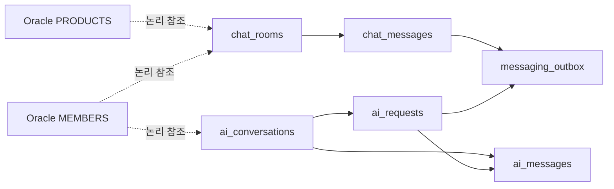

# PIKA v2 대화 데이터 모델 초안

- 갱신일: 2026-11-08
- 상태: MongoDB 논리 문서·인덱스 설계 제안. 실행용 validator·인덱스 스크립트는 아직 작성하지 않았다.
- 기준: [전체 ERD](data-model.md), [기능명세](functional-spec.md).
- Spring 내부 메시징 모듈이 사용자 채팅·AI 대화의 저장 소유권을 갖는 제안이다. Python은 조회·생성 계약으로 연결하고 컬렉션을 직접 수정하지 않는다.

## 1. 컬렉션 관계

실선도 MongoDB FK를 의미하지 않는다. 컬렉션 간 참조는 저장 모듈·validator·유일 인덱스·필요한 트랜잭션으로 관리한다. 공통 ID는 Oracle과 같은 UUID 문자열을 사용하고, 시각은 BSON Date의 UTC 값으로 저장한다. sequence는 64비트 정수로 관리하되 JSON·JavaScript 정밀도 문제를 피하도록 외부 계약에서는 문자열로 전달하는 안이다.

## 2. 사용자 채팅

### `chat_rooms`

| 필드 | 의미 |
| --- | --- |
| `_id` | 방 ID |
| `productId` | Oracle 상품 논리 참조 |
| `sellerId`, `buyerId` | 서버가 결정한 참여자. 판매자는 상품에서 도출 |
| `status` | `OPEN/CLOSED` 후보. 종료 뒤 새 메시지·이력 조회 정책은 별도 결정 |
| `lastSequence` | 저장이 완료된 마지막 메시지 순서 |
| `participants` | 정확히 2명의 회원 ID·역할·읽음/전달 위치를 담는 제한된 배열 |
| `participants[].lastReadSequence` | 각 회원이 실제 읽음을 확인한 마지막 위치. 온라인 여부와 분리 |
| `participants[].lastDeliveredSequence` | 기기로 전달 확인된 위치 후보. 계정 단위 최대값과 기기별 확인의 필요성 검토 |
| `lastMessageSummary` | 목록 표시용 마지막 메시지 요약. 원본 메시지에서 재구축 가능 |
| `createdAt`, `updatedAt`, `schemaVersion` | 생성·변경 시각과 스키마 버전 |

- 유일 인덱스: `(productId,buyerId)`. 상품 판매자는 변경하지 않으므로 동일 거래 상대 방 중복을 방지한다.
- 목록 인덱스 후보: `(sellerId,updatedAt DESC,_id DESC)`, `(buyerId,updatedAt DESC,_id DESC)`.
- 자기 상품 대화방 생성·판매자 임의 지정은 거부한다. 방 참여자의 동일 여부·배열 상한도 검증한다.
- 상품이 숨겨지거나 거래가 끝나도 기존 방을 즉시 물리 삭제하지 않는다. 새 문의 가능 여부와 기존 이력 조회 권한을 구분한다.

### `chat_messages`

| 필드 | 의미 |
| --- | --- |
| `_id` | 서버 메시지 ID |
| `roomId` | 채팅방 참조 |
| `sequence` | 방 내 서버 확정 저장 순서 |
| `senderId` | 인증 주체에서 도출 |
| `clientMessageId` | 클라이언트 재전송 식별자 |
| `payloadHash` | 같은 재전송 ID의 본문·첨부 변경 감지 |
| `type` | `TEXT/IMAGE/SYSTEM` 후보 |
| `text` | 크기 제한된 본문 |
| `attachments` | 제한된 개수의 `{assetId,mimeType,sizeBytes}`. Oracle 자산 논리 참조 |
| `createdAt`, `schemaVersion` | 서버 저장 시각과 스키마 버전 |

- 유일 인덱스: `(roomId,sequence)`, `(roomId,senderId,clientMessageId)`.
- 과거 메시지 조회는 `(roomId,sequence < cursor)` 정렬·제한 방식으로 한다.
- `_id`, `clientMessageId`는 인증·권한을 대체하지 않는다. 접속 세션에서 발신자를 도출하고 방 참여·파일 소유권을 검증한다.
- 같은 재전송 키·같은 payload는 기존 메시지·순서를 반환한다. 같은 키·다른 payload는 거부한다.
- 메시지마다 전체 수신자·기기 목록이나 무제한 수정 이력을 넣지 않는다. 읽음은 방의 회원별 위치로 계산한다.
- SYSTEM 이벤트는 서버만 생성한다. 사용자 payload로 SYSTEM 권한을 선택할 수 없다.

### 저장·확인 경계

1. 방 참여·메시지·첨부를 검증한다. 상품·회원 자격은 Oracle 소유 모듈 API와 정의된 이벤트 정책으로 확인한다.
2. Redis에 적재한 시점의 응답은 `ACCEPTED`이며 MongoDB 저장 완료와 구분한다.
3. MongoDB 트랜잭션에서 멱등성 확인·방 sequence 증가·메시지 삽입·방 요약 갱신·후속 outbox 삽입을 처리한다.
4. 커밋 후 `STORED` 확인과 실시간 전달을 수행한다. Redis 처리 ACK도 영구 저장 이후에 수행한다.
5. 전달 실패는 저장을 되돌리지 않는다. 재접속 시 MongoDB에서 이력을 복구한다.

sequence는 클라이언트 시각이나 Redis stream ID가 아닌 서버의 확정 저장 순서다. 한 방의 처리 순서를 유지하는 작업 분배 규칙을 정의하고, 다중 소비자에서 재시도가 순서를 깨뜨리는지 검증한다. Redis 전체의 순서가 모든 방의 처리 완료 순서를 자동 보장한다고 가정하지 않는다.

여러 문서의 원자적 변경을 택한 만큼 MongoDB replica set 구성이 필요하다. 개발·CI의 단일 노드 replica set은 트랜잭션 검증용이며 고가용성 구성이 아니다. 커밋·write concern·journal 설정과 ACK 의미를 함께 확정한다. 인덱스·validator는 테스트 시작 전에 만든다.

읽음 위치는 현재 값보다 작게 이동하지 않으며, 그 방의 저장 완료 위치를 넘지 않도록 한다. 기존 방 참여자에 대한 제한·탈퇴·차단 처리와 기존 연결 무효화는 후속 정책 결정 사항이다.

## 3. AI 대화

### `ai_conversations`

| 필드 | 의미 |
| --- | --- |
| `_id`, `ownerId` | 대화 ID와 회원 논리 참조 |
| `title`, `status` | 표시명·활성/보관/삭제 표시 상태 후보 |
| `lastSequence` | 메시지 표시 순서 |
| `activeRequestId` | 진행 중 요청 1건의 슬롯. 완료·실패·취소 처리 후 해제 |
| `summary` | 선택적 문맥 요약과 요약 기준 sequence·프롬프트 버전. 원문 대화의 대체 원본이 아님 |
| `createdAt`, `updatedAt`, `schemaVersion` | 공통 시각·버전 |

- 목록 인덱스: `(ownerId,updatedAt DESC,_id DESC)`.
- 초기 제안은 한 대화에 동시에 하나의 생성만 허용한다. 조건부 슬롯 확보와 요청·메시지 생성을 트랜잭션으로 처리한다.
- 슬롯이 찬 상태에서 새 입력을 거부·대기·기존 요청 취소 중 어떻게 처리할지는 UI 정책과 함께 확정한다.

### `ai_requests`

| 필드 | 의미 |
| --- | --- |
| `_id` | gRPC·WebSocket·관제에 전달할 request ID |
| `conversationId`, `ownerId` | 대화·소유자 참조 |
| `clientRequestId`, `payloadHash` | 회원 요청의 재전송과 본문 변경 확인 |
| `operation` | `PRODUCT_SEARCH/PRICE_ANALYSIS/REVIEW_SUMMARY` 후보 |
| `status` | `QUEUED/RUNNING/CANCEL_REQUESTED/COMPLETED/FAILED/CANCELLED` 후보 |
| `modelId`, `promptVersion`, `retrievalVersion` | 생성·검색 조건 기록 |
| `leaseUntil`, `executionAttempt` | 작업 소유·재시도 및 오래된 작업 결과 차단용 실행 세대 |
| `inputTokens`, `outputTokens`, `firstChunkAt` | 외부 응답에서 얻을 수 있는 사용량·관측값. 제공되지 않은 값은 NULL |
| `errorCode`, `startedAt`, `finishedAt` | 실패·실행 상태 |

- 유일 인덱스: `(ownerId,clientRequestId)`. 대화·입력도 hash 비교에 포함한다.
- 복구 작업 인덱스 후보: `(status,leaseUntil)`.
- 재시도 시 이전 Python 작업의 늦은 응답이 현재 결과를 덮지 않도록 request ID·executionAttempt·현재 상태를 함께 검사한다.
- 외부 모델 호출은 MongoDB 트랜잭션으로 묶을 수 없다. 완료 여부 불명확 시 무조건 재호출하지 않으며, 자동 재시도·중복 비용 허용 범위는 별도 정책으로 정한다.

### `ai_messages`

| 필드 | 의미 |
| --- | --- |
| `_id`, `conversationId`, `requestId` | 메시지·대화·생성 요청 참조 |
| `sequence`, `role` | 대화 표시 순서와 `USER/ASSISTANT` |
| `content`, `status` | 입력 또는 응답 snapshot. 응답은 생성 중·완료·중단·실패 구분 |
| `contentRevision` | 부분 응답 snapshot의 단조 증가 버전 |
| `citations` | 크기가 제한된 상품 ID·확인 기준 시각·검색 근거 요약 |
| `createdAt`, `updatedAt`, `schemaVersion` | 공통 시각·버전 |

- 유일 인덱스: `(conversationId,sequence)`, `(requestId,role)`.
- 이 모델은 요청마다 USER 입력과 ASSISTANT 응답 슬롯 각 1건을 전제한다. 재생성은 별도 request로 기록한다.
- 시스템 프롬프트는 서버의 버전 관리 대상으로 두고, 도구 호출 기록은 제한된 요청 진단 데이터 또는 별도 상세 모델로 관리한다. 도구 결과를 무제한 배열로 누적하지 않는다.
- 토큰 조각마다 문서를 생성하지 않는다. 메모리/전달 버퍼와 일정 간격 snapshot·최종 저장을 분리한다.
- 재접속은 최신 snapshot과 요청 상태를 조회하는 것으로 시작한다. 토큰 이벤트의 정확한 재생을 보장하려면 이벤트 보관 모델을 추가해야 한다.
- 완료 전 중단 시 부분 응답 보존·표시·이후 문맥 포함 여부는 미정이다. status만 COMPLETED로 위장하지 않는다.
- 대화 삭제 표시·소유권·요청 상태를 조회와 WebSocket 이벤트 전송 모두에서 확인한다.

## 4. MongoDB 후속 이벤트: `messaging_outbox`

`_id(eventId)`, `aggregateId`, `aggregateVersion`, `eventType`, `payloadSchemaVersion`, 크기 제한된 payload, `occurredAt`, 소비 대상별 상태·재시도·lease를 기록하는 지원 컬렉션을 제안한다.

메시지·AI 상태 저장과 같은 MongoDB 트랜잭션에 생성하고, Oracle 알림 등 외부 후속 처리로 전달한다. Oracle의 `NOTIFICATIONS`는 source event key로 중복을 막는다. Oracle outbox와 Mongo outbox를 하나의 DB 트랜잭션으로 묶지 않는다.

정확한 소비자 목록·이벤트 유일성·보존·정리 기준은 이벤트 계약에서 확정한다. 중복 제거 기록이 먼저 사라져 늦은 재전송을 새 요청으로 처리하지 않도록 멱등성 보관 기간도 함께 정한다.

## 5. 저장소 간 참조·보관 원칙

- 상품명·닉네임·아바타를 목록에 복제할 수 있지만 표시용 snapshot과 현재 권한 판단을 구분한다.
- Oracle 자산과 Mongo 첨부 연결은 원자적이지 않다. 첨부 권한 검증·참조 확정·실패 시 미참조 자산 정리와 삭제 재처리를 설계한다.
- 회원·상품 삭제 이벤트는 과거 거래·대화를 무조건 삭제하는 지시가 아니다. 접근 제한·익명화·보관 정책을 반영한다.
- TTL 삭제를 확정된 보관 정책 없이 켜지 않는다. 요청·대화·메시지·첨부·이벤트의 연쇄 정리는 명시적 작업으로 수행한다.
- 메시징·AI 데이터는 ELK 로그에 본문 전체를 기본 기록하지 않는다. 추적에는 ID·처리 상태·지연·오류 코드를 사용한다.

## 6. 검증·시드 시나리오

정상 방·다중 탭·미읽음·중복 client ID·다른 본문 재사용·오프라인 수신·방 접근 거부·소비 중단·저장 후 ACK 실패·AI 부분 생성·취소·늦은 조각·슬롯 회수 시나리오를 고정 seed로 생성한다.

시드 검증기는 Oracle 상품·참여자 ID와 Mongo 논리 참조, 유일 인덱스, 읽음 위치 상한, 요청·응답 상태 일치, outbox 재처리 결과를 검사한다. 부하 실행에서는 run ID별 ID manifest를 내보내 실제 저장 결과와 송신 결과를 대조한다.

## 7. 참고

- [MongoDB 원자성과 트랜잭션](https://www.mongodb.com/docs/manual/core/write-operations-atomicity/)
- [MongoDB 트랜잭션 지원](https://www.mongodb.com/docs/manual/core/transactions/)
