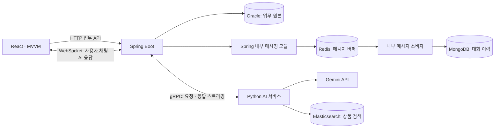

# PIKA v2 기술명세 초안

- 갱신일: 2026-11-11
- 상태: 기능명세와 함께 재검토 중. 원본 코드는 레퍼런스로 보존하고 v2는 새로 작성한다. 아래 내용은 구현 완료가 아닌 목표 구조다.
- 데이터 모델: [Oracle ERD](data-model.md) · [MongoDB 대화 모델](messaging-data-model.md).
- 검토 기준: [기능명세](functional-spec.md)의 권한·상태·수락 기준. 기능 범위 확정 후 세부 기술을 선정한다.
- 원본과의 차이: [기능 대조 기록](functional-audit.md).
- 거래 범위: 결제 샌드박스·구매 확정·리뷰까지.
- 거래 정책: 판매자 승인·택배 수동 발송·발송 전 구매자 취소·이후 관리자 처리. [정책 검토](transaction-policy.md).

## 1. 확정한 방향

| 영역 | 기술·방향 | 책임 |
| --- | --- | --- |
| 프런트엔드 | React · MVVM | V1 디자인을 차용하고 미완성·변경 흐름을 개선하며 코드는 새 구조로 구현. [화면 기준](design-record.md) |
| 업무 서버 | Java · Spring Boot, 모듈러 모놀리스 방향 | 회원·상품·주문·결제·리뷰·메시징을 명확한 내부 모듈로 구성 |
| 인증 | Spring Security · JWT | 기존 세션 로그인에서 전환 |
| 주 영속성 저장소 | Oracle 유지 | 회원·상품·주문·결제·리뷰 등 업무 데이터의 원본 |
| 메시지 영속성 | MongoDB | 사용자 채팅과 AI 대화의 저장 |
| 메시지 버퍼 | Redis | 메시지 처리량 완충과 후속 처리 연결 |
| 사용자 채팅·AI 응답 스트리밍 | WebSocket | 브라우저와 업무 서버 간 양방향 통신 |
| AI 서비스 | Python · gRPC | 업무 서버와 분리된 AI 처리 서비스 |
| 생성 모델 | Gemini API | 외부 추론 사용. Qwen 및 로컬 생성 모델 도입 계획은 제외 |
| 검색 | Elasticsearch | 상품 검색과 RAG 검색 기반 |
| 관제 | ELK | 로그 수집·검색·조회 |

MVVM은 React 프런트엔드의 화면 구조에 적용한다. 백엔드는 업무 도메인별 모듈과 공개 API·이벤트 경계로 구성하며, AI 서비스와는 gRPC 계약으로 연결한다. 메시징은 별도 Go·Rust 마이크로서비스를 기본 전제로 두지 않고 Spring 내부 모듈로 설계한다. Spring Modulith 도입 여부와 버전은 모듈 경계 검증 요구에 맞춰 선정한다. Java·Spring Boot의 업그레이드 버전, React 도구 체인과 세부 라이브러리는 아직 선정하지 않았다.

## 2. 서비스 경계와 통신

위 도식은 논리적 책임을 나타낸다. 초기 메시징과 소비자는 같은 Spring Boot 배포 단위 안에 두고, 실행 수·버퍼 상한을 제한한다. MongoDB 대화 저장 소유권은 메시징 모듈에 모으는 방향을 검토한다. 별도 서비스·언어와 서버 간 라우팅은 독립 확장·장애 격리 요구가 확인될 때 재검토한다. Oracle·MongoDB·Redis 사이에 단일 원자적 트랜잭션이 있다고 가정하지 않으며, 상태·식별자·재처리 기준을 기능별로 정의한다. 관제용 Elasticsearch와 상품 검색용 Elasticsearch의 인스턴스 공유 여부도 미정이다.

## 3. React MVVM 신규 구현

- **View**: React 컴포넌트로 화면을 표현하고 사용자 입력을 ViewModel에 전달한다.
- **ViewModel**: 화면별 custom hook 등의 형태로 조회·입력·로딩·오류 상태와 사용자 동작을 관리한다.
- **Model**: 도메인 데이터와 API·WebSocket 접근 모듈을 관리한다.
- WebSocket 연결·재접속과 이벤트 해석은 공통 통신 모듈에서 처리하고 ViewModel에 이벤트를 전달한다.
- 가격·재고·구매 권한 같은 업무 규칙의 최종 검증은 백엔드에서 수행한다.

상태 관리 라이브러리, 서버 상태 캐시, 라우터, TypeScript 도입 여부와 API 스키마 생성 방식은 별도 선정한다.

## 4. 메시징과 AI 스트리밍 설계 과제

외부 실시간 통신은 WebSocket, Spring Boot와 Python 사이의 내부 AI 통신은 gRPC로 구성한다. Gemini 응답 조각을 Python → gRPC → Spring Boot → WebSocket 순서로 전달한다.

- 사용자 채팅은 `messageId`, AI 생성 요청은 `requestId`로 식별한다.
- AI 이벤트는 시작·응답 조각·완료·실패·취소 확인을 구분한다. 조각 순서와 최종 저장 상태를 정의한다.
- AI 생성 취소를 Python 서비스까지 전파한다. 외부 API 작업 취소 가능 범위와 취소 이후 도착한 응답의 처리도 정한다.
- 접수·영구 저장·상대방 전달·읽음 확인을 서로 다른 상태로 관리한다.
- 재접속 후 대화 이력·생성 상태를 복구한다. 연결 종료 시 생성 지속·중단 정책을 정한다.
- 인증, 대화방 접근 권한, 연결별 버퍼 상한, 느린 클라이언트 처리와 요청 한도를 설계한다.
- Redis는 Streams + Consumer Group을 우선 후보로 검토한다. ACK·재처리·중복 제거·보관 정책과 서버 간 최종 전달 방식은 확정이 필요하다.
- MongoDB는 사용자 채팅과 AI 대화의 스키마를 구분한다. AI 응답 조각의 버퍼링·중간 저장 주기와 완료·중단 시 저장 정책을 정한다.

## 5. 검색·RAG 제안

상품 데이터에 기반한 RAG를 검토한다. 아직 구현 또는 모델 선정이 완료된 사항은 아니다.

1. Oracle의 상품 정보를 검색용 문서로 구성하고 임베딩한다.
2. Elasticsearch에서 BM25와 벡터 검색을 수행한다.
3. 가격·카테고리·판매 상태 등의 구조화 조건을 적용하고, 결과를 통합·중복 제거한다.
4. 경량 리랭커로 후보를 재정렬한다.
5. 최신 가격·판매 상태를 Oracle에서 재확인한다.
6. Gemini에 근거 상품 정보를 전달하고 상품 링크와 함께 답변을 생성한다.

임베딩 모델, 리랭커, 검색 결과 결합 방식은 미정이다. 검색 후보 30건 → 최종 5건은 초기 실험값이며 평가 결과에 따라 조정한다. 별도 벡터DB 추가보다 기존 Elasticsearch의 벡터 검색 활용을 우선 검토한다.

색인은 Oracle에서 재구축할 수 있어야 한다. Outbox 기반 색인 갱신·삭제·재처리를 검토하고, 상품 변경에 따른 임베딩 갱신 범위를 정의한다. 시세 통계는 거래 데이터에서 계산하며, 검색 결과만으로 실제 거래가를 추정한 값과 혼동하지 않도록 한다.

## 6. 관제·자원·검증

- ELK에 서비스 간 추적을 연결하기 위해 OpenTelemetry 도입을 검토한다.
- 메시지 저장 지연·미처리 건수, 검색 반영 지연, 검색·리랭킹 지연, AI 첫 응답 시간·실패·토큰 사용량을 측정한다.
- 검색용·관제용 Elasticsearch는 설정을 분리 가능하게 구성한다. 개발 환경에서의 공유 여부는 메모리 사용량을 측정한 뒤 결정한다.
- 현재 개발 장비는 Ryzen 7 6800H, OS 인식 RAM 약 14GiB, RTX 3060 Laptop GPU 6GiB다. Gemini API를 사용하고 관제·개발 서비스를 선택 실행할 수 있도록 구성한다.
- DB 마이그레이션·파일 저장소 분리를 후속 설계한다. 반복 가능한 시드와 GitHub Actions·GHCR·Compose 배포 후보, Playwright·k6 검증 방향은 [CI/CD·시딩·부하 검증 계획](delivery-and-test-plan.md)에 기록했다. 스크립트·워크플로는 구현 전이다.
- 구매·리뷰 권한, 결제 상태 전이, 메시지 중복·순서·재접속, gRPC 지연·취소·실패를 검증한다.
- 검색은 BM25 / 하이브리드 / 하이브리드+리랭커를 비교하고 Recall@K·nDCG@K·지연을 평가한다.

## 7. 기능 요구를 먼저 확정할 항목

- 판매 단위·판매자 승인·택배 수동 발송·취소 주체는 확정. 주문 상태 세부, 만료 시간·배송비·자동 확정·환불 예외 정책을 추가 검토
- 채팅방·읽음·다중 접속·대화 보관·AI 취소 정책
- AI 기능·관리자 제재·후속 기능의 첫 구현 범위

기능별 열린 결정은 [기능명세의 결정 목록](functional-spec.md#8-열린-제품-결정)에서 관리한다.

## 8. 후속 기술 결정 항목

- React 도구 체인·상태 관리·서버 상태 캐시·라우터
- 임베딩 모델·리랭커와 실행 위치
- Redis Streams 상세 구성, ACK·재처리·메모리 상한. 서버 간 실시간 전달은 다중 인스턴스 요구에 따라 검토
- 대화 저장 소유권과 다중 저장소 간 실패 복구
- WebSocket 인증·이벤트 계약·재접속·생성 취소 정책
- 검색·관제 Elasticsearch 배치와 데이터 보관 기간
- 언어·프레임워크·컨테이너 버전 및 Gemini 모델 ID
