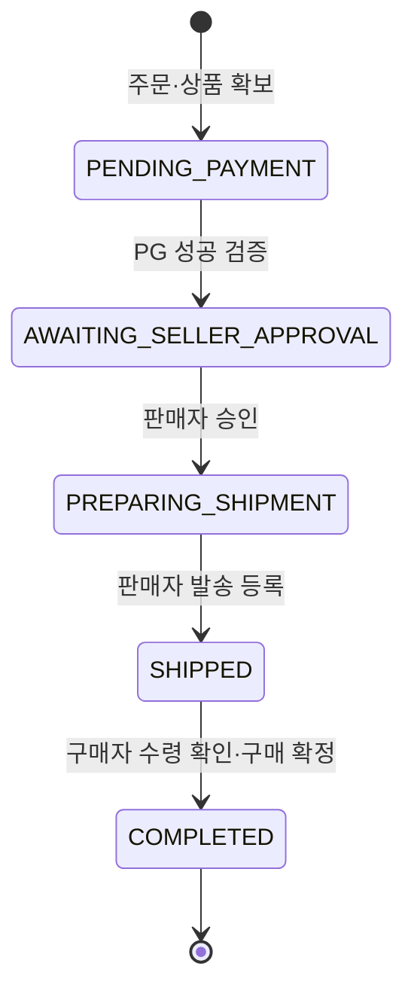

# PIKA v2 거래 정책·상태 전이 검토

- 검토일: 2026-11-08
- 상태: 사용자 선택을 반영한 논리 설계 검토. 구현·실결제 운영 규정이 아니다.
- 관련: [기능명세](functional-spec.md), [Oracle ERD](data-model.md).

## 1. 확정한 정책

| 항목 | 결정 |
| --- | --- |
| 판매 단위 | 게시글 1건당 물품 또는 묶음을 한 번 판매 |
| 결제 범위 | 샌드박스 결제·구매 확정·리뷰 |
| 판매자 승인 | 결제 검증 후 판매자가 승인해야 배송 준비로 전환 |
| 거래 방식 | 택배만 지원. 판매자가 택배사·운송장을 수동 입력 |
| 구매자 취소 | 발송 전에는 구매자가 취소 가능 |
| 발송 후·구매 확정 후 | 관리자 경로로 처리. PG 환불 결과와 처리 사유·이력 보존 |

아래 상태 이름·동시성 처리·DB 모델은 위 정책을 구현하기 위한 설계안이다. 다음 절의 발송 판정·수령 확인 규칙도 상세 설계 기준으로 제시하며, 자동 배송 조회·자동 구매 확정·반품 워크플로는 구현 범위로 확정하지 않는다.

## 2. 정상 거래 흐름

- 승인 전 상품은 `RESERVED`이며 다른 구매자가 주문할 수 없다. 구매 확정 때 `SOLD`로 전환한다.
- 판매자 승인·발송은 해당 주문 판매자, 구매 확정은 해당 주문 구매자만 수행한다.
- 수동 운송장 구조에서 서비스의 **발송 판정은 택배사·운송장과 함께 발송 등록이 커밋된 시점**으로 설계한다. 실제 택배 집하·배송 완료를 자동 확인했다고 표시하지 않는다.
- 구매 확정은 `SHIPPED`에서 구매자가 수령을 확인하는 동작으로 설계한다. 자동 확정 기간과 배송사 API 연동은 미정이다.
- `ORDER_DELIVERY_SNAPSHOTS`에 주문 생성 시 수령인·연락처·배송지를 고정한다. 배송지 변경은 첫 설계에서 기존 주문 취소·재주문 경로를 사용하고, 변경 지원은 후속 검토한다.
- 구매자 자신이 판매하는 상품은 구매·승인할 수 없다. 주문의 채택 결제·금액은 클라이언트 ID나 상품의 현재 가격만으로 결정하지 않는다.

## 3. 취소·거절·환불

| 상황 | 처리 주체·전이 | 데이터·상품 처리 |
| --- | --- | --- |
| 결제 대기 중 구매자 취소 | 구매자 → `CANCELLING` | 새 결제 시도 차단. 기존 결제 결과를 조회하고 성공 건이 있으면 환불 확인 후 종료 |
| 결제 성공·승인 대기 중 구매자 취소 | 구매자 → `CANCELLING` | 채택 결제의 취소·환불 성공 확인 후 `CANCELLED` |
| 배송 준비 중 구매자 취소 | 구매자 → `CANCELLING` | 발송 등록과 경쟁하므로 같은 주문 상태를 원자적으로 검사·갱신 |
| 판매자 승인 거절 | 판매자 → `CANCELLING` 경로를 쓰는 설계안 | 사유 기록 후 같은 PG 확인·환불·이력 보존 경로 사용 |
| 발송 등록 이후 취소 요청 | 일반 구매자 자동 취소 거부 | 관리자 경로로 확인·환불 처리. 자동 반품 신청·회수·검수 흐름은 범위 미확정 |
| 구매 확정 이후 환불 | 관리자 → `REFUND_PROCESSING` | 기존 `confirmed_at`·주문 전이·결제 사실 보존. 환불을 구매 확정 이전으로 단순 되돌리지 않음 |
| 환불 결과 미확정 | 취소·환불 처리 상태 유지 | claim·예약 환불액을 유지하고 PG 재조회·재처리 |
| 환불 실패 확정 | 상태·PG 결과를 재검증해 적절한 이전 상태 복귀 또는 운영 조치 | 자동 claim 해제·재판매 금지. 실패 확정 요청의 환불 예약액만 해제 |

첫 취소 명령은 채택 결제의 미환불 전액을 대상으로 설계한다. 관리자 부분 환불·분쟁·정산은 세부 정책 미정이다. `REFUNDS.amount`는 금액 이력을 위해 유지하되 필드가 있다는 이유로 부분 환불 UI를 구현 범위에 넣지 않는다.

외부 결제가 존재하지 않음을 확인했거나 미발송 취소의 환불이 완료되면 주문 `CANCELLED`·claim 제거·상품 `AVAILABLE` 복귀를 같은 Oracle 트랜잭션에서 처리한다. 환불할 성공 건이 없으면 환불 레코드를 억지로 만들지 않는다.

발송 이후·구매 확정 이후 전액 환불 완료는 주문 `REFUNDED`로 기록하는 안이다. **환불 완료는 실물 회수 완료가 아니다.** 기존 claim을 유지하고 상품은 재판매 판단 대기 `HOLD`로 두는 안을 적용한다. 자동 재판매를 하지 않으며 실물·새 게시글 생성·재판매 승인 정책은 후속 검토한다. 미발송 취소와 발송 이후 환불의 종료 처리를 같은 로직으로 묶지 않는다.

## 4. 경합·중복·외부 실패 검토

### 승인·취소·발송

- 승인·취소·발송 명령은 주문 version과 현재 상태를 같은 짧은 트랜잭션에서 검사·변경한다.
- 승인이 먼저 끝났더라도 아직 미발송이면 구매자 취소는 허용한다.
- 취소가 먼저 `CANCELLING`을 확보하면 승인·발송을 거부한다.
- 발송이 먼저 `SHIPPED`로 커밋되면 구매자 자동 취소를 거부하고 관리자 경로를 안내한다.
- 운송장 입력 화면을 여는 행위는 발송 등록이 아니다. 발송 등록·`SHIPMENTS` 생성·주문 상태·이력·이벤트는 함께 커밋한다.
- 같은 승인·발송·취소 명령의 재전송은 상태와 요청 식별자를 확인해 기존 처리 결과를 반환한다. 다른 본문의 같은 키는 거부한다.

### 결제·환불

- PG 호출 중 Oracle 행 잠금을 유지하지 않는다. 외부 처리 이후 요청 ID·주문 version·최신 상태를 확인해 반영한다.
- 취소 중 늦게 도착한 성공 결제를 승인 대기로 되살리지 않는다. 결제 사실을 기록하고 취소·보상 흐름으로 처리한다.
- 추가 결제 시도의 초과 성공은 `EXCESS_PAYMENT` 환불 대상으로 기록한다. **정상 채택 결제·주문·배송을 취소하거나 claim을 해제하지 않는다.**
- 한 결제에 성공·진행·결과 미확정 환불액을 함께 계산하고 결제 행에 대한 직렬화로 과환불을 방지한다.
- 환불 목적(`ORDER_CANCELLATION/ADMIN_REFUND/EXCESS_PAYMENT`)과 요청자·실행자·이전 주문 상태를 기록한다. 자동 보상에서는 시스템 actor를 명시한다.
- 관리자 환불과 구매 확정이 경쟁하면 주문 상태를 통해 직렬화한다. 환불 처리 중에는 구매 확정·신규 리뷰 작성을 거부한다.

## 5. ERD 반영

| 모델 | 반영 내용 |
| --- | --- |
| `ORDERS` | 승인 대기·배송 준비·발송 상태, `seller_approved_at`, `confirmed_at`과 version |
| `ORDER_DELIVERY_SNAPSHOTS` | order PK/FK. 주문 시 고정한 수령인·전화·주소·배송 요청 |
| `SHIPMENTS` | order 유일. 택배사·운송장·발송 등록자·시각·version. 기본은 주문당 최초 발송 1건 |
| `REFUNDS` | 목적·요청자·처리자·이전 주문 상태·예약 환불액 계산 기준 |
| `ORDER_TRANSITIONS` | 승인·취소·발송·확정·환불 전이를 감사 가능하게 보존 |
| `PRODUCT_CLAIMS` | 미발송 취소 완료 시 해제, 발송 후 환불은 유지하는 분기 |

`SHIPMENTS`의 존재는 이 설계에서 발송 등록을 의미한다. 운송장 초안이 필요하면 별도 UI 상태로 관리하고 발송 사실과 섞지 않는다. 잘못 입력한 운송장 정정 이력, 재배송·반송 모델은 후속 검토한다.

## 6. 수락·시드 시나리오

1. PG 검증 성공 후 주문은 승인 대기이고 판매자 승인 전 발송 등록은 거부된다.
2. 판매자 승인 후 주문은 배송 준비이며 구매자 수령지 snapshot을 사용한다.
3. 다른 회원이 승인·발송·확정·관리자 환불을 시도하면 거부된다.
4. 승인과 구매자 취소가 겹쳐도 미발송 취소 권리가 사라지지 않는다.
5. 취소·발송 경쟁에서 한 전이만 성공하고 shipment·주문 상태가 일치한다.
6. 환불 실패·결과 미확정 중에 상품이 재판매되지 않는다.
7. 초과 성공 결제의 환불이 정상 주문·배송을 취소하지 않는다.
8. 발송 후 구매 확정은 한 번만 반영되고 리뷰 자격·알림이 중복 생성되지 않는다.
9. 구매 확정 이후 관리자 환불도 확정 시각·이력을 보존하고 자동 재판매하지 않는다.
10. 이미 작성된 리뷰의 환불 이후 표시 정책은 미정으로 남기며, 확정되지 않은 정책을 시드의 정답으로 고정하지 않는다.

## 7. 남은 세부 결정

결제·판매자 승인 대기 만료 시간, 배송비 부담·계산 방식, 회원 연락처·배송지 보관, 운송장 정정·재배송, 자동 구매 확정 여부, 관리자 부분 환불·반품·분쟁 범위, 환불 후 기존 리뷰 표시가 미정이다. 이 항목들은 이번 정책 선택과 구분해 추적한다.
